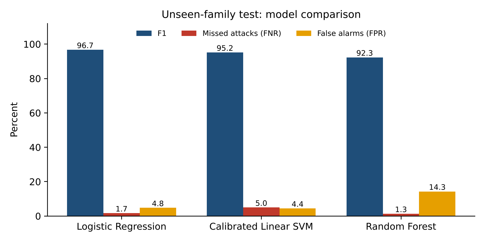
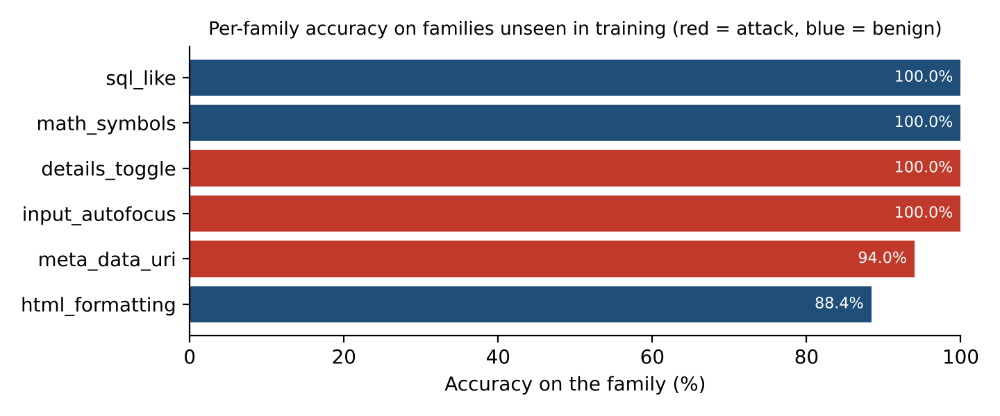

# XSS-Sentry

A small, local machine-learning detector for **Cross-Site Scripting (XSS) payloads**. It un-hides encoded input, scores it, and tells you *why* it was flagged. Everything runs on your own computer from the command line, with no network access, and the text it inspects is never executed or rendered.

```text
$ python scan.py "%3Cimg%20src%3Dx%20onerror%3Dalert(1)%3E"

Input    : %3Cimg%20src%3Dx%20onerror%3Dalert(1)%3E
Decoded  :    (1 decoding layer(s))
Verdict  : XSS SUSPECTED   (probability 0.9xx, severity CRITICAL)
Signals  :
   - event_handler: inline event handler (onerror=, onload= ...)
   - risky_tag: tag commonly abused as an XSS carrier
   - dangerous_call: JS call typical of PoC payloads
```

## How it works

1. **Safe decoding** (`features.py`): URL, HTML-entity and `\uXXXX` layers are peeled in memory (up to 4 rounds) so disguised payloads are analysed in their true form.
2. **Features**: 3,000 character n-gram (2-4) TF-IDF values + 10 readable pattern indicators (script tag, inline event handler, `javascript:` scheme, attribute break-out, ...) + 5 numeric signals.
3. **Models** (`train.py`): Logistic Regression, Calibrated Linear SVM and Random Forest are compared; the one with the best F1 on unseen attack families is saved.
4. **Scanner** (`scan.py`): verdict, probability, severity, decoded text and the signals that fired.

## Quick start

Python 3.10+.

```bash
python -m venv .venv
source .venv/bin/activate          # Windows: .venv\Scripts\activate
pip install -r requirements.txt

python train.py                    # trains, evaluates, saves models/xss_model.joblib and outputs/*
python scan.py ""
python scan.py --file my_inputs.csv --column payload   # batch mode -> scan_results.csv
python scan.py                     # interactive mode
pytest                             # unit tests for the decoder and indicators
```

The dataset (`data/xss_dataset.csv`) is committed; `python generate_dataset.py` rebuilds the same file (fixed seed 42).

## Dataset

7,400 unique, synthetic rows: 3,200 XSS payloads and 4,200 benign inputs. Each row carries a `family` (11 attack styles, 11 benign kinds) and an `obfuscation` tag (case change, URL encoding, HTML entities, unicode escapes, whitespace, comment splitting). Benign data includes **hard negatives**: harmless text that merely mentions words like "script" or "alert". Payloads use harmless demo actions only (`alert`, `console.log`, `example.test` URLs).

## Results (honest version)

A random split is misleading here: generated payloads follow templates, so **every model scores 100% on a random 80/20 split**. That is memorisation, not skill. The meaningful test withholds whole families from training (3 attack and 3 benign families, 1,751 rows):

| Model | F1 | Precision | Recall | Missed attacks (FNR) | False alarms (FPR) |
|---|---|---|---|---|---|
| Logistic Regression **(selected)** | 96.70% | 95.10% | 98.35% | 1.65% | 4.76% |
| Calibrated Linear SVM | 95.16% | 95.27% | 95.05% | 4.95% | 4.43% |
| Random Forest | 92.28% | 86.65% | 98.70% | 1.30% | 14.29% |

*Reproducibility note:* Logistic Regression and the SVM reproduce exactly when you re-run `train.py`. The Random Forest row can shift a little between machines and library versions (observed F1 90.0-92.3%, false alarms 14.3-19.4%), but it was never the selected model, and the selection did not change. The table above is from the first run.




**Known weaknesses** (found by error analysis, not hidden):
- All 14 missed attacks are `<object data="data:text/html;base64,...">` payloads: there is no Base64 decoding layer yet.
- All 43 false alarms are ordinary HTML (lists, tables): the training data had no plain-HTML benign examples.
- Model selection used the unseen-family set, so its scores are slightly optimistic for the chosen model.

## Limitations

- Synthetic data: results show generalisation across *generated* attack styles, not performance on all real-world input.
- This is a screening aid. It does **not** replace output encoding, input sanitisation or a Content Security Policy.

## Roadmap

- [ ] Base64 decoding layer + plain-HTML benign samples, then re-run the unseen-family test
- [ ] Separate validation split for model selection
- [ ] Evaluate on real payload samples from public security write-ups
- [ ] Context awareness (HTML body vs attribute vs URL)

## Project layout

```text
generate_dataset.py   builds data/xss_dataset.csv
features.py           safe decoder + indicator features + explanations
train.py              trains/compares models, writes models/ and outputs/
scan.py               command-line scanner
tests/                unit tests
data/                 dataset
docs/                 result charts used in this README
```

## Responsible use

For learning and defensive work only. Use it on systems and data you own or are authorised to test.

## License

MIT, see [LICENSE](LICENSE). Author: Aman Verma.
